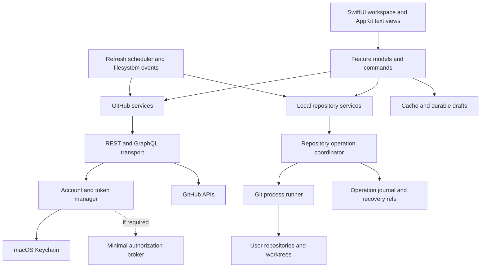
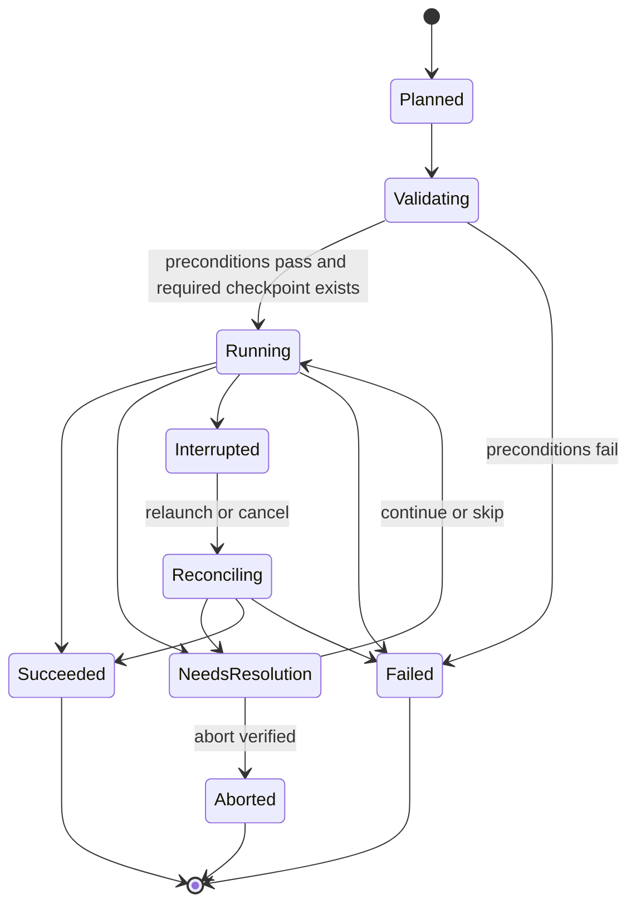

# Proposed technical architecture

12 November 2026 · Proposals to validate in M0

## 1. Technology choices

| Concern | Proposed choice | Reason and validation |
| --- | --- | --- |
| Application | Swift 6 language mode, SwiftUI, targeted AppKit integration | Native windows/menus/accessibility; AppKit for high-volume text/diff controls when SwiftUI measurements justify it. Pin the exact stable Xcode/SDK in M0. |
| Platform | macOS 15 minimum, Apple Silicon first | A proposed compatibility baseline, not a user constraint. Decide Intel support against current build tools and available hardware. |
| Structure | One macOS app with a small number of local Swift packages | Clear dependency boundaries without a package per screen. Swift Package Manager for approved dependencies. |
| Git | Bundled, version-pinned Git CLI; Swift process wrapper | Required advanced operations should use Git's own implementation. Validate signing, licensing, helpers, LFS, SSH, and update strategy before adoption. |
| HTTP | URLSession, Codable, typed endpoint definitions | Own cancellation, authentication, errors, and rate policy. Consider selective generated REST models after a schema-size spike. |
| GraphQL | Named operations with typed responses; generation decision in M0 | Share transport/auth but keep GraphQL error and pagination semantics distinct. Avoid a giant schema model in views. |
| Concurrency | Swift structured concurrency and actors | Isolate credentials, network scheduling, persistence, and Git mutation coordination. UI state changes on MainActor. |
| Persistence | SQLite with a thin reviewed Swift layer | Predictable migrations, queryable cache, and full-text search option. Compare GRDB and a smaller wrapper in M0; no dependency version chosen yet. |
| Secrets | macOS Keychain | Keep account tokens and refresh tokens outside the content database. [Keychain services](https://developer.apple.com/documentation/security/keychain-services). |
| Distribution | Direct download, Developer ID signing, notarization, signed updates | Better initial fit for Git tools and user repositories; Mac App Store remains a separate feasibility project. |

The application and first-party helper code are Swift. Bundling Git, LFS, and necessary native libraries does not turn the app into a web wrapper. A libgit2-first approach is an alternative if the shipping spike fails, but its advanced-operation and signing compatibility would need separate proof.

## 2. Component layout

Suggested package boundaries:

- **Domain:** account/host/resource identities, capability states, operation results, Git snapshots; no UI or HTTP types.
- **GitHubKit:** endpoint implementations, GraphQL operations, DTO mapping, transport, rate policy, capability discovery.
- **GitEngine:** process runner, parsers, repository discovery, command plans, coordination, recovery and fixtures.
- **Persistence:** cache, drafts, search index, migrations and account erasure.
- **MacApp:** feature models, routing, views, native integrations, composition and lifecycle.

Start with these boundaries; add abstractions only where they hide a real integration or simplify meaningful tests. Feature models coordinate workflows; views do not run Git or construct API payloads.

## 3. Identity and data model

Use stable identifiers, not display names, as keys. A repository cache key includes host + account ID + GitHub repository ID. A local repository has its own ID, canonical working-tree path, common Git directory, worktree Git directory, selected transport account, and per-repository author/signing preferences.

Keep REST numeric IDs, GraphQL node IDs, issue/PR numbers, Git object IDs, and local file paths as different types. A GitHub account is not the same thing as a commit author or SSH identity. Remote-to-GitHub matching must tolerate multiple remotes, forks, renamed repositories, and non-GitHub remotes without silently assigning credentials. Local Git sessions do not require GitHub authentication; API failure must not disable independent local work.

Core persisted records: AccountMetadata, HostProfile, RepositoryCache, LocalRepository, Worktree, IssueSnapshot, PullRequestSnapshot, ReviewDraft, CommentDraft, NotificationThread, WorkflowRunSnapshot, SavedQuery, SyncCursor, CapabilityEvidence, OperationRecord and RecoveryCheckpoint.

Represent folder-to-GitHub associations separately from Git remote configuration. Each association records local repository/worktree identity, selected remote name, verified host/repository ID, account context, last verification and connection state. Permit multiple local checkouts per GitHub repository and multiple remotes per local repository; make the active checkout and push target explicit. Normalize paths to detect duplicates, retain folder-access information as required by the chosen sandbox model, and revalidate moved folders before reconnecting them. Removing an association must not remove a remote or local files.

The folder connection coordinator inspects existing Git roots/remotes before proposing changes. Run remote configuration and history checks through the existing Git operation coordinator. Treat permission/network failure as unknown remote state, never as proof that a remote is empty. For importing an ordinary folder into a populated remote, clone separately and preview selected file copies with collision/symlink checks and Git-metadata exclusion; preserve the source folder and require explicit commit/push.

Every cache record has account ownership, source revision/time, and completeness information. On sign-out, delete private cache, thumbnails, search entries, and account drafts after offering draft export. Do not delete cloned repositories or change Git configuration. Clones are user-owned data with a distinct lifecycle.

## 4. Authentication and trust boundaries

Use `ASWebAuthenticationSession` for the browser authorization experience; do not embed a password form. Bind each attempt to unpredictable state and PKCE verifier, expected host, account context, and an exact callback policy. Validate cancellations, callback replay, and account changes. [Apple authentication session](https://developer.apple.com/documentation/authenticationservices/aswebauthenticationsession).

The provisional OAuth strategy and its unresolved secret-exchange issue are documented once in [API-COVERAGE.md](API-COVERAGE.md). DISC-02 is a hard prerequisite for production authentication. Tokens stay in Keychain, refresh is serialized per account, and revocation produces a recoverable sign-in state. Multiple windows must not rotate the same refresh token concurrently.

If a broker is required, scope it to authorization exchange/refresh. Store the app secret server-side, bind requests to short-lived authorization transactions, prevent arbitrary callback/proxy URLs, rate-limit exchanges, and redact all token material. Prefer stateless forwarding of user token responses without retaining repository data; document transient token exposure and retention. Add its deployment, monitoring, cost, and incident ownership to the plan before adopting it. A broker is not a webhook relay.

Treat repository config, paths, Markdown, patch text, URLs, logs, archives, and subprocess output as untrusted input. Render sanitized content with no script execution or ambient credential access. Open external URLs through a validated scheme/host policy. Authenticate only approved API/transport hosts; never forward Authorization headers to arbitrary redirect or download hosts.

Do not claim Keychain encrypts the content database. Use restrictive local permissions, disclose private-data caching, rely on the device's storage protections, and allow users to disable/clear content caching. Evaluate database encryption if the chosen privacy threat model requires it.

## 5. Git engine and operation state

### Process execution

Execute an approved absolute executable with a structured argument array and explicit working directory. Never build shell command strings from repository names, refs, paths, or commit messages. Separate arguments and paths with Git's supported terminators, use machine-readable/NUL-delimited output, and tolerate unusual/non-UTF-8 filenames.

Bound stdout/stderr buffering, stream progress, implement cancellation for child processes, and distinguish stopped processes from safely aborted Git operations. Git may leave rebase/merge state that must be inspected and resumed. Do not delete lock files solely because an operation appears slow.

Provide a narrow credential/askpass bridge scoped to an approved host and operation. Avoid tokens in argv, remote URLs, broad environment dumps, or persistent Git config. Respect SSH host-key verification, configured agents, and selected account identity; never disable verification to resolve a connection problem.

Normal read operations must not execute external diff/textconv helpers. Repository hooks, filters, LFS, signing tools, credential helpers, SSH commands, and external merge tools require a defined trust policy; showing a repository is not authorization to run arbitrary commands in its configuration. Avoid silently changing the user's global configuration.

### Coordination

Serialize mutating operations across all worktrees sharing a common Git directory. Read-only work can run concurrently against stable snapshots, but views must invalidate after mutations or filesystem events. External terminals and editors can still change refs/indexes, so recheck preconditions immediately before execution and reconcile afterward.

An operation has an ID, type, repository/worktree, preconditions, planned effects, expected refs, checkpoint policy, progress, and final evidence. State transitions are explicit:

### History editing and recovery

Build a typed rebase plan; write only validated sequence-editor instructions. Do not expose arbitrary `exec` commands in the visual editor. Support edit/split through explicit stop-and-resume steps. Merge-containing ranges require a tested preserve-merges plan or a clearly blocked variant, never silent flattening.

Before amend/rebase/reset/drop operations, record starting refs, index/worktree status and recoverable checkpoints. A recovery ref preserves committed objects only. Dirty tracked changes, staged intent, untracked content and overwritten files need separate preservation or a refusal to proceed; ignored files must not be swept into backups without a deliberate choice. Disk-full or checkpoint failure blocks the mutation.

Prefer recovering a commit to a new branch, which is easier to inspect than immediately resetting the working branch. Do not call this a universal undo: external tools, untracked files, expired recovery data, and remote writes limit what can be restored. Define visible retention and storage limits. Git reflogs provide additional reference history, not a backup of all local files. [Reflog reference](https://git-scm.com/docs/git-reflog).

When rewriting a published branch, capture the remote ref the user reviewed and send an explicit expected-SHA lease. A background fetch must not redefine that expectation. Handle rejection as a new remote-state decision; never retry with unrestricted force. [Force-with-lease semantics](https://git-scm.com/docs/git-push).

## 6. GitHub transport and synchronization

Use one transport policy shared by REST and GraphQL, with independent endpoint-specific mapping. Include explicit API version, content negotiation, request IDs, redaction, cancellation, timeout, retry classification, and per-account budgets. GraphQL can return usable data alongside errors; preserve both rather than treating HTTP 200 as success.

Refresh active views first, then inbox/visible work queues. Deduplicate identical reads and use ETag/Last-Modified where supported. Store cursors and coverage boundaries; paginate on demand instead of mirroring every accessible repository. Back off when hidden, offline, rate limited or on battery, and reconcile on wake.

A remote write follows validate → submit → reconcile → display confirmed state. A timeout after submission is **outcome unknown**, not proof of failure. Check for the created comment/review or changed state before offering a resubmit. Do not assume a local UUID makes GitHub writes idempotent. Destructive operations and CI dispatch are never queued for silent offline replay.

Issue/comment/review drafts are durable local records. Compare the draft's base version with current server data before editing remote content; preserve both versions if no conditional update is supported. PR reviews also record commit SHA, path, line side/range, and patch context. If a patch is missing or truncated, obtain a trustworthy complete diff or disable line-level submission for that region.

For log/artifact/release downloads, stream to a temporary destination, handle redirects and expiry, and ask for a save location. Inspect archives before extraction; reject traversal/symlink escapes and oversized expansion. Never automatically execute downloaded artifacts.

## 7. Native UI composition

Main window: account/workspace sidebar → repository or work-item list → detail with optional inspector. Repository destinations: Overview, Local, Issues, Pull Requests, Actions, and later Releases/Projects/Settings. The Local tab contains a checkout picker plus Changes, History and Branches/Worktrees. Before connection it offers Connect Folder and Clone Repository; afterward it shows folder path, remote/account, branch, change counts and synchronization state. Global destinations: Inbox, My Work, Local Folders, Search, and saved workspaces. Local Folders also provides the folder-first and signed-out entry points.

Use a shared command model for menus, keyboard shortcuts, toolbar buttons and command palette so availability and behavior stay consistent. Keep active account and target repository visible for remote writes. The operation panel shows what is running, whether it can be cancelled, and whether resolution is required.

Use native text and table controls for diffs/logs when profiling shows a benefit. Virtualize by file/hunk/line and avoid building attributed strings for entire giant files. Offer unified and side-by-side diffs with accessible line descriptions. A bounded sanitized Markdown renderer is acceptable; the application shell remains native and does not embed github.com pages as its feature implementation.

## 8. Distribution and maintenance

Prototype Developer ID signing and hardened runtime with the actual Git/helper bundle early. Apple describes signing executables, hardened runtime and notarization for this distribution route. [Notarizing macOS software](https://developer.apple.com/documentation/security/notarizing-macos-software-before-distribution).

Direct-download distribution without App Sandbox is the proposed baseline, pending the packaging spike. Sandbox feasibility requires testing repository folder access, subprocesses, agents, signing helpers, and bookmarks; do not assume all fail or all work. [App Sandbox configuration](https://developer.apple.com/documentation/xcode/configuring-the-macos-app-sandbox).

Ship dependency notices and corresponding-source/licensing materials as required by the selected Git/helper distributions; decide the application license separately. Choose and review a signed updater in M0 (Sparkle is a candidate, not yet adopted). Test interrupted updates, signature rejection, rollback policy, cache-schema compatibility, and the clean-machine installation path. Revalidate dependencies and Git security fixes on a defined maintenance cadence.

## 9. Validation strategy

- **Unit:** parser boundaries, patch/line mapping, capability state, endpoint encoding, permission/error mapping, and state transitions.
- **Integration with real Git:** isolated temporary repositories, a bare remote, multiple clones and linked worktrees; verify resulting refs/index/tree/content using Git, not only mocked command arguments.
- **API contract:** sanitized fixtures for pagination, partial GraphQL errors, permission denial, rate limiting, version changes and ambiguous writes; opt-in live tests against disposable GitHub resources.
- **UI:** critical keyboard and accessibility journeys, multiple accounts/windows, empty/loading/stale/error states, large diffs/logs and conflict tools.
- **Failure injection:** terminate during rebase/merge, disk full, lock contention, dropped connection after accepted writes, changed remote SHA, expired credentials, malformed paths and interrupted updates.
- **Performance:** repeatable fixture sizes and hardware; compare cold/warm cache, full/partial diff, quiet/busy filesystem, and wake/reconnect. Store p50/p95 and peak memory evidence.

Tests concentrate on repository integrity and integration boundaries. Screenshot-only tests or mocks that merely echo the command construction cannot establish Git correctness.
