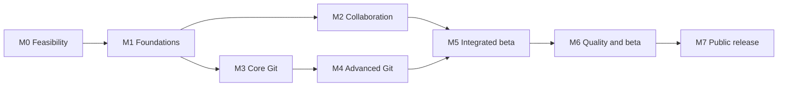

# Delivery plan

12 November 2026 · Planning estimate, not a delivery commitment

## 1. Delivery strategy

Build two cooperating product areas: GitHub collaboration and local Git. Deliver thin end-to-end workflows, then expand their breadth. Introduce real-Git integration tests, recovery design, accessibility, and packaging early; they are not finishing tasks.

Public 1.0 includes advanced Git, as confirmed by the user. The smaller alpha milestones are opportunities to learn, not a proposal to redefine the first public release. Broader GitHub administration is a separate continuing roadmap with explicit API coverage tracking.

Use [PRD.md](PRD.md) as the release contract, [API-COVERAGE.md](API-COVERAGE.md) for capability facts, [ARCHITECTURE.md](ARCHITECTURE.md) for proposed implementation, and [TASKS.md](TASKS.md) for execution. Resolve contradictions in that order and record material changes in [DECISIONS.md](DECISIONS.md).

## 2. Staffing and estimate assumptions

Baseline: two experienced engineers with Swift/macOS and Git/API experience, part-time product/design support, and QA/security support for release hardening. This is an estimating assumption; no team or budget has been provided. An authorization broker, if needed, also requires backend operating ownership.

| Milestone | Focus | Engineering effort | Exit evidence |
| --- | --- | --- | --- |
| M0 | Product/technical feasibility | 3–5 engineer-weeks | Tested auth strategy, Git runtime/distribution proof, diff prototype results, compatibility registry and decision records |
| M1 | Application foundations | 6–10 engineer-weeks | Native shell, account isolation, storage, transport, CI and error/state patterns |
| M2 | Collaboration alpha | 10–16 engineer-weeks | Repository → issue → review → merge/checks journey works on dedicated test resources |
| M3 | Core Git alpha | 12–18 engineer-weeks | Clone/open → stage → commit → fetch/pull/push, history, tags, remotes and checkpoints |
| M4 | Advanced Git | 16–24 engineer-weeks | Rebase/cherry-pick/reset/conflicts/worktrees recover after failure and restart |
| M5 | Integrated feature-complete beta | 8–12 engineer-weeks | Cross-feature journeys, full Actions controls, signing/LFS/submodules and onboarding |
| M6 | Quality and private beta | 8–12 engineer-weeks | Performance, accessibility, integrity, privacy and compatibility evidence meets the PRD |
| M7 | Public release | 3–5 engineer-weeks | Signed/notarized package, verified updater, support material and release report |
| **Total before contingency** | **M0–M7** | **66–102 engineer-weeks** | **Re-estimate after M0 and first completed vertical slices** |

For two engineers, a reasonable initial planning envelope is **42–64 calendar weeks** including approximately 25% contingency and uneven parallelism. Illustrative checkpoints: collaboration alpha around weeks 10–16; core Git alpha around weeks 18–28; feature-complete beta around weeks 30–48. These are low-confidence ranges, not independently additive promises.

A solo implementation is roughly **83–128 working weeks** at the same scope before accounting for part-time availability. More engineers help only where work can be separated; Git correctness and shared UI integration remain bottlenecks. Use actual throughput after M0 to revise the estimate. Broad API parity after 1.0 has no credible fixed date until its endpoint audit and priorities are agreed.

Budget separately for developer program/signing access, a domain and download hosting, macOS CI, test devices/OS versions, telemetry/support tooling if chosen, dependency maintenance, and broker hosting if required. Obtain actual prices when creating a budget; none are assumed here.

## 3. Milestones and gates

### M0 — Prove the difficult assumptions

Run discovery and technical spikes before building all screens:

1. Register a development integration and test sign-in/refresh/revoke and notifications under the chosen token model.
2. Bundle Git/helpers in a minimal Swift app and test HTTPS/SSH, signing, LFS, notarization and clean-machine launch.
3. Build a disposable-repository test harness and exercise interrupted rebase, conflicts and recovery.
4. Measure native diff/history rendering against large fixtures.
5. Establish a capability registry and freeze the first 20 user-workflow scripts.

**Gate:** no unresolved feasibility issue on production authentication, shipping Git, or preserving user work. If a spike fails, revise its architecture and estimate; do not conceal the issue behind a working mock. Record the proposed macOS minimum, CPU support and distribution decision.

The [12 November feasibility audit](M0-FEASIBILITY.md) freezes the 20-script discovery contract and records local bundled-runtime/recovery and rendering measurements. M0 remains open. Complete registered-app live evidence first, then clean-machine/signed distribution and accessibility checks, curate representative API permissions/operations, and resolve architecture/operational ownership before approval. Keep the product estimates provisional until those critical-path results support a revision.

### M1 — Create reusable foundations

Build account-aware navigation, native command routing, typed API transport, cache/draft storage, Git process primitives, and local diagnostics. Establish structured concurrency conventions and fixture-based testing.

**Gate:** two accounts and multiple windows cannot exchange credentials/data; a cache migration and sign-out erasure test pass; permission and offline states are usable; CI builds and tests the application/packages on the selected baseline.

### M2 — Collaboration alpha

Ship to an invited internal cohort: repository browsing, focused work queues, notification triage where verified, issue operations, PR creation/review/merge, and Actions visibility. Include review revision safety and draft persistence from the first version.

**Gate:** a contributor can find work, create an issue/PR, review and merge a permitted PR; read-only and restricted-org accounts see accurate states; oversized or incomplete diffs cannot generate misplaced review comments.

### M3 — Core Git alpha

Introduce repository setup, the Local tab and folder-connection flow, selective staging, commit identity, branches/tags, remotes, synchronization, history, stashes and the first recovery panel. Provide both repository-first and folder-first entry points. Test real Git outcomes rather than only checking invoked arguments.

**Gate:** a fresh supported Mac completes clone → edit → selective stage → commit → push. Existing clones and ordinary folders can connect through the Local tab; populated remotes use a history-aware connection or separate-clone import path. Test mismatched remotes, multiple checkouts, moved folders and unlinking without file loss. Dirty trees, non-fast-forward pushes, detached HEAD, external edits and failed checkpoint creation preserve user data.

### M4 — Advanced Git

Deliver merge tools, interactive rebase including edit/split, cherry-pick, revert/reset, reflog recovery, worktrees and published-history protection. Make operation continuation/abort visible after relaunch.

**Gate:** every required advanced operation passes the crash/conflict/recovery suite. A stale expected remote SHA is rejected safely. No required operation is counted complete solely because the UI opens a terminal.

### M5 — Connect the whole product

Integrate issue-to-branch, fork-aware PR checkout/creation, CI diagnosis, Git signing, LFS/submodules, account-aware remote credentials, saved workspaces and onboarding. Complete Actions dispatch/rerun/cancel/downloads.

**Gate:** all APP/HUB/GIT requirements have implementation evidence; all six PRD journeys work end to end, including folder connection, mixed-account and fork cases. Missing variants are documented and resolved against the release contract.

### M6 — Validate with users and adverse conditions

Recruit 10–20 representative testers with a mixture of new and experienced Git users, small-team maintainers, SSH/signing setups and large repositories. Collect consented diagnostics and conduct moderated recovery tests. Expand to enough usage to assess the crash-free target.

**Gate:** PRD NFR targets and workflow measures meet their release thresholds or have an explicitly recorded product decision. No unresolved data-loss, credential, recovery, or incorrect-review-position defect. Documentation states actual limitations.

### M7 — Ship and support

Verify the final package from a clean machine, including update from the preceding beta. Publish install/help/privacy/support pages and dependency notices; rehearse revocation of a bad update and support escalation for recovery cases.

**Gate:** release checklist signed off by product, engineering and QA roles; all required tasks have evidence; the published coverage report accurately separates native operations and handoffs. Actual release/publication happens during implementation, not during this planning task.

## 4. Dependency and parallel work model

After foundations, an engineer can lead Git engine/recovery while another leads GitHub services/UI. Both review shared contracts and cross-feature operations. Accessibility, fixtures, instrumentation and distribution work continue throughout; milestone placement indicates the release gate, not the first day they receive attention.

Critical path: auth/packaging feasibility → process/account foundations → core Git snapshots/checkpoints → conflict/rebase state → recovery verification → integrated beta → release. If staffing is constrained, defer post-1.0 administration and optional polish before removing confirmed full-Git scope.

## 5. First implementation iteration

The first iteration should produce evidence, not a large scaffold:

- DISC-01: agree workflow fixtures and release scope.
- DISC-02: test production-suitable authentication and notification access.
- DISC-03: prove the packaged Git runtime and signing path.
- DISC-04: benchmark diff/history rendering.
- DISC-05: create the operation/token/permission registry.
- DISC-06 and DISC-07: consolidate decisions, prototypes and revised estimates.

Then build the smallest native app capable of a real sign-in and repository list. Add read-only PR detail followed by a single correctly anchored review; independently prove status → selective stage → commit against a disposable repository. Use these slices to replace estimates with observed throughput.

## 6. Working cadence and definition of done

Use short feature branches/PRs, reviewed acceptance criteria, and task-sized vertical slices. In each weekly review, show a working workflow, test evidence, unresolved risks, and changes to the capability register. Re-estimate at every milestone; track scope additions explicitly.

A task is done only when its acceptance criteria pass, meaningful tests cover its integration/failure risks, relevant accessibility/error/offline states are present, diagnostics are redacted, and documentation/coverage state reflects the implemented behavior. A feature is not done because its API request returned once.

For release-blocking defects, severity is based on user impact: data loss, cross-account disclosure, invalid history mutations or misplaced reviews stop release; ordinary UI polish does not automatically have the same priority.

## 7. After 1.0

R1 emphasizes useful individual/team workflows: Projects, Discussions, releases, security alerts, repository administration, richer Actions/environments, gists/search, and selected packages/Pages support. R2 addresses organization/enterprise administration, extra hosts, audit/billing/SCIM, cloud-development integrations and advanced API families.

Each R1/R2 epic begins with capability/permission verification, receives user-facing acceptance criteria, and is split into implementation tasks before entering a sprint. New APIs and web-only features remain visible in the inventory. Do not let “all GitHub features” become an unbounded release gate with no testable denominator.
